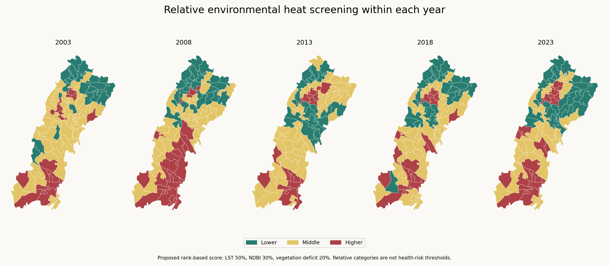
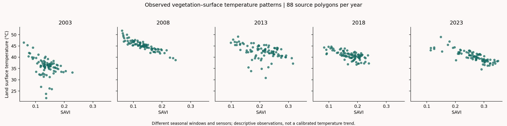
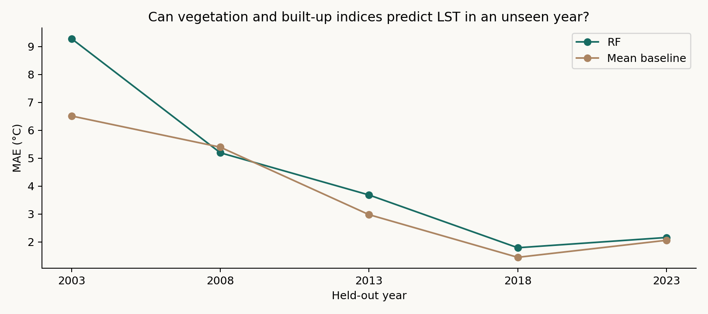

# Spatiotemporal Urban Heat Vulnerability Assessment — Multan, Pakistan (2003–2023)

*Exploratory environmental screening using Google Earth Engine, Colab and machine learning*
**Reader guide:** [Project structure and report status](docs/PROJECT_GUIDE.md) · [Public portfolio](https://musab-shahid-earth-observation.brinycourt4.chatgpt.site/)


**Earth observation · polygon-level GIS · model evaluation · reproducible Python**

An exploratory study by **Musab Shahid** of land-surface temperature, vegetation and built-up indicators across Multan district, Pakistan, at five benchmark years: **2003, 2008, 2013, 2018 and 2023**.



This project connects satellite extraction, careful spatial joins, exploratory screening and honest out-of-sample model evaluation. It follows the earlier [Spatiotemporal Analysis of Urban Heat Island Effect in Multan, Pakistan (2013–2023) project](https://github.com/musab-shahid/multan-uhi-analysis), with a different district-wide polygon framework and validation emphasis.

## Explore

| Resource | Purpose |
|---|---|
| [Research report (PDF)](docs/REPORT.pdf) | Standalone narrative, results, figures and limitations |
| [Executable analysis notebook](notebooks/Analysis.ipynb) | Reproduce the release from supplied CSV exports |
| [Analysis script](src/analyze.py) | Data checks, screening, validation, figures and GeoJSON |
| [Methods and limitations](docs/METHODS.md) | What the results support and what they do not |
| [Review of earlier experiments](docs/REVIEW.md) | Why earlier calibration and health-risk claims were retired |
| [Results](results/) | Tables, validation metrics and environment record |
| [GIS package](gis/Multan_Heat_Screening_GIS.zip) | Portable QGIS project, five GeoPackage layers and matching styles |
| [Map book](gis/Multan_Heat_Screening_Map_Book.pdf) | Five finished yearly map layouts |
| [Spatial and weight robustness](docs/ROBUSTNESS.md) | Buffered geographic evaluation and 66 scenarios per year |
| [Year-specific GeoJSON layers](maps/) | Separate layers with verified polygon identities |
| [Drive research archive](https://drive.google.com/drive/folders/1J7LbZQI04QIAeuQi4SkdS5KcJzGQ4ePA) | Preserved notebooks, source exports and raster files; access may be restricted |

## Scope and findings

- **440 polygon-year records**, representing **88 source polygons** in five years. Repeated council codes represent separate source features; 88 polygons should not be described as 88 unique administrative councils.
- Descriptive LST/SAVI/NDBI summaries retain **all five years**. The original four-variable classifier retained only 352 records because its VIIRS product starts in 2014 and provides no 2013 lights.
- The new screening score ranks polygons **within each year** using LST (50%), NDBI (30%) and vegetation deficit (20%). These are proposed exploratory weights, not literature-calibrated health thresholds.
- In a separate LST regression experiment, Random Forest's mean fold MAE was **2.42°C** for held-out council groups versus **3.22°C** for the mean baseline. For held-out years, RF was worse: **4.42°C** versus **3.68°C**. Temporal generalization is weak.
- The legacy RF reproduced its constructed classes with approximately **86.65%** mean grouped accuracy in this local rerun. The preceding Colab run reported 86.37%; library versions differ and this is not independent vulnerability validation.
- New geographic-block evaluation with a **5 km exclusion buffer** gives RF mean fold MAE **2.99°C**, versus **3.44°C** for the baseline. Performance varies by block; mean fold R² is −0.18.
- Across **66 weight scenarios per year**, top-14 overlap with the baseline ranges from **10 to 14 polygons** across all years and scenarios. Selection frequencies describe this grid, not probabilities of vulnerability.





## Run

From the repository root, with Python 3:

```sh
python -m pip install -r requirements.txt
python src/analyze.py
python src/robustness.py
python -m unittest discover -s tests -v
```

Or open `notebooks/Analysis.ipynb` after cloning the repository. No Earth Engine authentication or new satellite download is required for this release analysis. The exact tested versions are recorded in [results/environment.json](results/environment.json).

The script checks one-to-one polygon-year joins and geometry stability, creates all results and figures, and exports separate GeoJSON files for every year. It writes only generated release outputs.

## Current release

The executed notebook runs both scientific stages. Six tests pass. The seven-page research report and five-page map book include the new results; the QGIS project was tested after relocation. [Release notes](docs/RELEASE_NOTES.md) describe the scope. Original exports and historical analyses remain preserved.

## Interpretation boundaries

LST is satellite-observed **surface temperature**, not air temperature or a health outcome. Different seasonal windows, sensors and observation coverage prevent a calibrated long-term temperature-trend claim. The relative screening maps compare locations within a year; their colors do not demonstrate cooling or warming between years. No socioeconomic or clinical vulnerability has been validated. The original council-group holdout is complemented by explicit geographic blocks with 0, 2 and 5 km buffers; neither demonstrates reliable transfer to an unseen year.

This is a completed **exploratory portfolio release**, not a validated operational heat-health tool or peer-reviewed publication. Further primary-data work would be needed for those claims.

## Data and attribution

The supplied data are user-generated Earth Engine exports from Landsat Collection 2 Level 2 and VIIRS. Geometry comes from the user's `Multan_UCs` asset. Its original boundary licensing and vintage have not been independently established; no blanket open-data license is asserted. See [data provenance](docs/DATA_PROVENANCE.md). Raw rasters and historical notebooks remain in Drive.

## Related research

[Spatiotemporal Analysis of Urban Heat Island Effect in Multan, Pakistan (2013–2023)](https://github.com/musab-shahid/multan-uhi-analysis) · [ERA5 monsoon — collaborative study](https://github.com/musab-shahid/multan-era5-monsoon-analysis) · [Drought Event Analysis in South Punjab, Pakistan](https://github.com/musab-shahid/south-punjab-drought-analysis)

Suggested citation: Shahid, M. (2026). *Spatiotemporal Urban Heat Vulnerability Assessment — Multan, Pakistan (2003–2023): exploratory polygon-level analysis and validation audit*. Research portfolio release.

