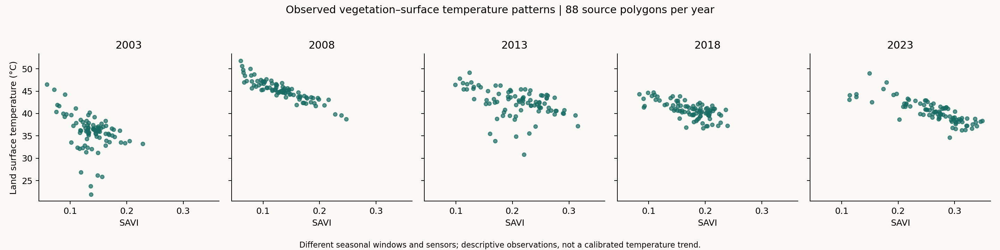
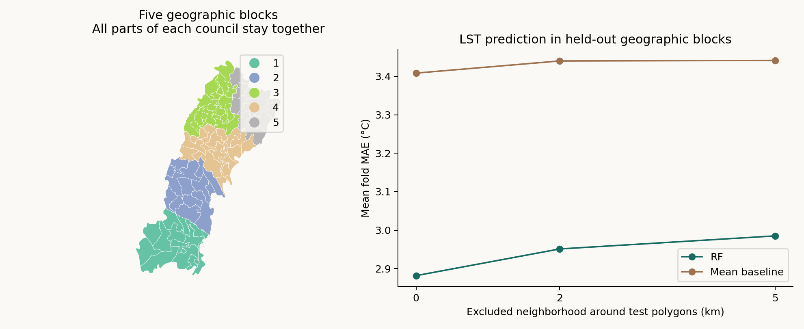
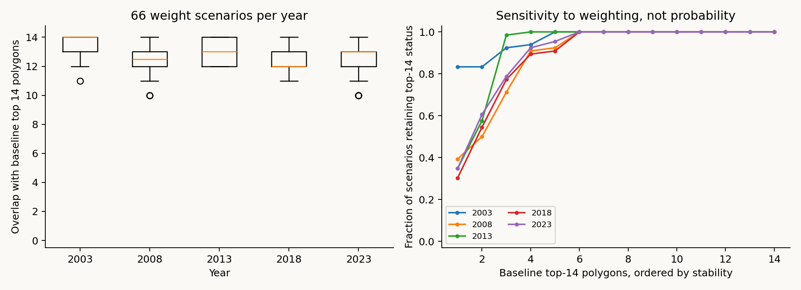

# Spatiotemporal Urban Heat Vulnerability Assessment — Multan, Pakistan (2003–2023)

Exploratory environmental screening using Google Earth Engine, Colab and machine learning

**Musab Shahid | Research report | Revised 9 November 2026**

## Abstract

This study evaluates satellite surface-temperature, vegetation and built-up indicators for 88 source polygons in Multan at five benchmark years. All 440 polygon-year observations are retained in a transparent within-year environmental screening score. The source polygons represent 82 council codes; repeated codes are kept together during model evaluation.

The current release adds geographic block validation with 2 and 5 km exclusion buffers and 66 additive weight scenarios for each year. At a 5 km buffer, Random Forest mean fold error is 2.99°C compared with 3.44°C for a training-mean baseline. Errors and explanatory performance vary across blocks. Previously evaluated transfer to an unseen year remains poor: RF mean fold error is 4.42°C, worse than the 3.68°C baseline.

Across the full weight grid, 10–14 of the baseline top 14 polygons remain in the selected group, depending on year and weights. These scenario counts describe sensitivity to assumptions, not probabilities of vulnerability. A portable GIS release provides five separate yearly layers, styled layouts and a map book.

## Research contribution

The contribution is a reproducible link between polygon identity, environmental screening, model-transfer evaluation and usable GIS outputs. It supports investigation of relative surface conditions within each benchmark year. It does not establish a calibrated warming trend, population exposure, clinical vulnerability or a causal vegetation-cooling effect.

## 1. Data and study design

The inputs are the supplied Earth Engine polygon-statistics export and the preserved legacy model-results table. No new satellite extraction was performed for this release. Geometry is carried from the user’s Multan_UCs asset and preserved using SOURCE_ID.

| Year | Sensor | Historical window | Scenes | Polygons |
|---|---|---|---|---|
| 2003 | Landsat 7 | 1 April–30 May | 6 | 88 |
| 2008 | Landsat 7 | 1 June–1 July | 2 | 88 |
| 2013 | Landsat 8 | 1 June–1 July | 8 | 88 |
| 2018 | Landsat 8 | 1 June–1 July | 6 | 88 |
| 2023 | Landsat 9 | 1 June–1 July | 8 | 88 |

End dates are exclusive. The source workflow uses Landsat Collection 2 Level 2 products, cloud/shadow masking, scale factors, median composites and a water mask. Valid-pixel fractions were not supplied. Two scenes in 2008 do not demonstrate that Landsat 7 SLC-off gaps were repaired.

The VIIRS product chosen by the historical workflow starts in 2014. Earlier missing or placeholder lights are not observed zero radiance. The current score therefore uses LST, NDBI and SAVI in all five years. The 352-row legacy classifier is retained only for historical comparison; its constructed labels are not independent vulnerability observations.

## Polygon identity and joins

Each year has 88 unique SOURCE_ID values with stable geometries. Council names and codes repeat across years and, for some councils, across source polygons. The legacy snapshot was matched with a verified composite key; new spatial layers already contain their own attributes. A five-year table must never be joined by ward name alone.

LST is surface temperature, not air temperature. SAVI and NDBI describe spectral signals rather than independently validated land-cover fractions. Historical extraction windows, sensors and observation coverage differ, so year means are descriptive summaries rather than calibrated long-term trends.

## 2. Screening and descriptive results

Within each year, variables receive average percentile ranks. The baseline score is 0.50 × rank(LST) + 0.30 × rank(NDBI) + 0.20 × [1 − rank(SAVI)]. Lower, Middle and Higher use score cutoffs at 1/3 and 2/3. These are proposed exploratory categories, not equal-size terciles or health thresholds.

| Year | Mean LST (°C) | Mean SAVI | Lower / Middle / Higher |
|---|---|---|---|
| 2003 | 35.91 | 0.137 | 23 / 44 / 21 |
| 2008 | 45.24 | 0.133 | 28 / 31 / 29 |
| 2013 | 42.43 | 0.209 | 24 / 41 / 23 |
| 2018 | 40.79 | 0.173 | 27 / 37 / 24 |
| 2023 | 40.36 | 0.263 | 29 / 32 / 27 |

The means summarize polygon means without area weighting. Every year contributes all 88 source polygons. No health, demographic or population-exposure data are present. Rank colors are recalculated each year; color changes cannot be interpreted as physical warming or cooling.

The screening formula is unchanged from the preceding release. New robustness analyses examine its dependence on weights and the separate LST model’s dependence on geographic proximity.

## 3. Geographic model evaluation

The separate regression predicts LST from SAVI and NDBI. It uses 200 trees, minimum leaf size 3 and seed 42, with no test-fold tuning. Five geographic blocks are formed from dissolved council centroids in UTM 42N using KMeans (seed 42, 20 starts), without using LST. All parts and years of a council remain in one block.

Each block is held out in turn. The buffered variants remove entire training councils if any part lies within 2 or 5 km of a test polygon. Distances use complete polygon geometries, not just centroid distances. Zero denotes the same geographic blocks without a buffer. Both models use the same retained training records.

| Exclusion buffer | RF MAE (°C) | Baseline MAE (°C) | RF fold MAE range |
|---|---|---|---|
| 0 km | 2.88 | 3.41 | 1.91–4.05 |
| 2 km | 2.95 | 3.44 | 1.96–4.07 |
| 5 km | 2.99 | 3.44 | 1.96–4.12 |

At 5 km, training folds retain 41–63 councils. RF beats the baseline on MAE in four of five blocks, but its mean fold R-squared is negative (−0.18). A modest average error advantage does not imply reliable prediction everywhere. Buffers test geographic separation; they do not prove independent residuals or eliminate shared year effects.

## 4. Temporal transfer and weighting assumptions

The earlier council-group holdout gives RF mean fold MAE 2.42°C versus baseline 3.22°C. Leave-one-year-out gives RF 4.42°C versus baseline 3.68°C, with negative RF R-squared in every held-out year. The new spatial tests retain all years in training and test blocks; they do not solve prediction in a new year or a simultaneous new place and year.

Weight sensitivity now covers all nonnegative triples summing to one in 0.1 increments: 66 scenarios per year, including single-indicator extremes. Each selects the top 14 polygons; ties are resolved by SOURCE_ID. The grid is a deliberate stress test, not a claim that all weights are equally plausible.

| Year | Scenarios | Minimum / median / maximum overlap | Always in top 14 |
|---|---|---|---|
| 2003 | 66 | 11 / 14 / 14 | 10 |
| 2008 | 66 | 10 / 12.5 / 14 | 9 |
| 2013 | 66 | 12 / 13 / 14 | 11 |
| 2018 | 66 | 11 / 12 / 14 | 9 |
| 2023 | 66 | 10 / 13 / 14 | 9 |

The stable core supports a focused review of consistently high-ranked locations, while unstable positions should be reported with their rank range and scenario counts. It does not validate optimal intervention priorities, because the score has no external health or exposure target.

## 5. GIS deliverables and map interpretation

The portable GIS package contains a GeoPackage with five year-specific layers, a QGIS project using relative paths, matching styles and five print layouts. The project opens with only 2023 visible. Each layer has 88 features, one YEAR and unique SOURCE_ID values, with current RELATIVE_SCORE and RELATIVE_CLASS attributes.

Open Multan_Heat_Screening.qgz in QGIS, switch on one year at a time, and use its matching layout. ArcGIS Pro can read the GeoPackage layers; the .qgz project and .qml styles are QGIS-specific. The data CRS is WGS84 and the layouts use WGS84 / UTM zone 42N for scale and distance.

These maps replace the old RF-class presentation for current interpretation. In particular, 2013 now displays all 88 screening polygons because the current score does not require missing nighttime lights. The historical RF maps remain archived and should not be mixed with the new categories.

## 6. Reproducibility, limitations and conclusion

Run src/analyze.py from the repository root to rebuild the existing screening, regression checks and GeoJSON layers; then run src/robustness.py for the spatial and weighting analyses. The updated notebook executes both stages. The GIS builder uses the separate QGIS Python runtime; report rendering uses reportlab and pypdf.

Six tests check the weight grid, scenario accounting, test-record uniqueness, council membership and buffer distances, recalculated prediction errors, and preservation of the baseline score. Source-file hashes and exact settings are stored with the results. GIS checks verify one year and 88 unique feature identities per layer; relative paths support moving the project with its GeoPackage.

## Limits of the evidence

This release does not re-extract harmonized seasonal imagery, quantify missing-pixel coverage, validate boundaries against an authoritative current source, or calibrate sensors. The original boundary vintage and redistribution terms remain unverified. Existing provider rights apply; no blanket geometry license is granted.

The five geographic blocks and three buffer settings are a prespecified sensitivity design, not an exhaustive spatial-validation study. No block layout or buffer was selected for favorable model scores. There are only five folds. Spatial and temporal tests answer different prediction questions, and neither validates the constructed screening score against health outcomes.

The project now provides a more complete assessment of geographic transfer, explicit all-year weight sensitivity and directly usable GIS materials. Its defensible contribution remains exploratory environmental screening with transparent limitations, rather than an operational heat-health model.

## Sources and attribution

[Landsat Collection 2 Level 2 products](https://developers.google.com/earth-engine/datasets/catalog/LANDSAT_LC09_C02_T1_L2)

[VIIRS VCMSLCFG product](https://developers.google.com/earth-engine/datasets/catalog/NOAA_VIIRS_DNB_MONTHLY_V1_VCMSLCFG)

[scikit-learn grouped cross-validation documentation](https://scikit-learn.org/stable/modules/cross_validation.html)

[QGIS project and vector writer API](https://qgis.org/pyqgis/master/core/QgsProject.html)

[Public research repository](https://github.com/musab-shahid/multan-environmental-heat-screening)

Research by Musab Shahid. The November release includes AI-assisted code development, verification and editing. Suggested citation: Shahid, M. (2026). Spatiotemporal Urban Heat Vulnerability Assessment — Multan, Pakistan (2003–2023). Exploratory research report, revised 9 November 2026.
